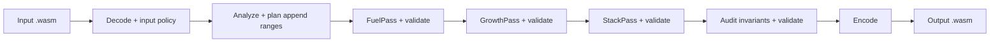

# MoonWasm FuelGuard

[](#current-status)
[](#current-status)
[](#current-status)
[](https://www.moonbitlang.com/blog/moonbit-1-0-rc)
[](LICENSE)

Build-time fuel metering and resource guards for MoonBit WebAssembly modules.

MoonWasm FuelGuard instruments a normal `moon build --target wasm` module with a
fixed execution budget. The CLI can also cap WebAssembly memory growth and
externref table growth. Exhaustion records a trap code and site. Instrumentation
adds no imports and requires no host-side fuel API.

> FuelGuard is a resource-control tool, not a security sandbox. It does not limit
> host imports, wall-clock time, or file and network access.

## Why FuelGuard

MoonBit's primary runtime artifact is WebAssembly, but the MoonBit toolchain and
the current MoonBit hosts do not provide a portable instruction budget:

- `moon test` has no fuel or timeout option, so a runaway wasm test can stall CI.
- `moon_cove` reports source coverage; it does not impose an execution budget.
- wasm5 has no fuel support, and wasmoon's `fuel`/`budget` options are not implemented.
- Rust/C++ instrumentation tools cannot be embedded cleanly in a MoonBit build.

FuelGuard moves the budget into the module at build time. A host only needs to load
and run the instrumented wasm; it does not need to implement fuel accounting.
The goal is a portable, reproducible runtime contract, not a gas model identical
to Wasmtime.

## Current status

[Production specification v4](docs/14_FuelGuard生产规格_v4.md) is the sole
implementation and acceptance specification. The current checkout passed the
Linux correctness and delivery checks. S55 records the historical performance
results. See S63 for the current candidate's performance retest.
[S62 correctness evidence](docs/evidence/S62.md) · [S63 performance evidence](docs/evidence/S63.md)

See the [v4 project status](docs/project-status.md) for the A20 construction
retest and the remaining release tasks.

The table describes the existing prototype and its historical verification.
The CLI defaults to the `production-v1` profile, which requires both
`--max-stack-units` and `--max-call-depth`. Use `--stack-layout` to inspect
the per-function costs.

| Area | Status |
| --- | --- |
| Input policy | Rejects GC types, multiple memories/tables, and reserved exports |
| Decode / validate / encode | Implemented with staged errors |
| Pass API and pipeline | The built-in pipeline applies Fuel, Growth, and Stack. Third-party passes are experimental. Standalone `GuardPass` returns `NotImplemented` for enabled guard settings. |
| FuelPass | Production-v1 uses a single Fuel v2 layout with weighted span debits. |
| `instrument` CLI | Wasm file pipeline for Fuel, Growth, and Stack. Use a new output path for each run. |
| Real MoonBit fixture | Built, instrumented, and checked end to end |
| Growth guards | CLI caps defined wasm32 memory and externref table growth. The respective grow instructions require explicit limits. |
| Stack protection | Call-site stack and depth budgets with export, start, and fixed-table wrappers. [S11 evidence](docs/evidence/S11.md) · [S12 evidence](docs/evidence/S12.md) |
| Native `run` adapter | Linux x86_64 with wasmoon 0.18.0, trap diagnostics, and instance retirement. [S13 evidence](docs/evidence/S13.md) |
| Runtime smoke checks | Linux S02 verified export and initialization traps on wasmoon and Wasmtime |
| Named differential corpus and demo | 69 named cases, including 24 control-flow or stack boundaries, and F0–F3 passed on wasmoon and Wasmtime. [S35 evidence](docs/evidence/S35.md) |
| Generated corpus and unified acceptance | 10,000 distinct inputs were instrumented, independently validated, and executed with Fuel v2 in both engines. [S35 evidence](docs/evidence/S35.md) |
| Mooncakes release | The public 0.2.1 CLI runs through `moonx`. This checkout declares a separate 0.2.2 candidate. [Package and installation evidence](docs/evidence/S70.md) |

## Quick start

Quick start requires MoonBit 1.0 RC, Git, Python 3, and a POSIX shell. For the
fixed toolchain and package installation, see the
[installation and migration guide](docs/install.md).

Run these commands from the root of the candidate checkout or its extracted
local source package. For a fresh Mooncakes index, start with `moon update`.

```bash
python3 -B scripts/prepare-dependencies.py .
moon check --frozen --target wasm --deny-warn
moon test --frozen --target wasm
```

Instrument the included real MoonBit fixture:

```bash
moon run cmd/instrument --target wasm -- \
  fixtures/hello/hello.wasm \
  -o _build/hello.fuel.wasm \
  --fuel 100000 \
  --max-stack-units 100000 \
  --max-call-depth 128 \
  --max-memory-pages 64 \
  --max-table-elements 64 \
  --allow-import wasi_snapshot_preview1.fd_write \
  --report _build/hello.fuel.json
```

The CLI stages and verifies files in private subdirectories of their destinations, then
publishes the Wasm and finally the optional manifest with no replacement.
`--report` writes a JSON manifest with the input and output SHA-256, model and
layout versions, configuration, and a determinism declaration. The verifier
rebuilds the static Fuel v2 span table from the Wasm guards.
[Manifest format](docs/implementation/manifest-v2.md)

When migrating a command that selects an older codegen layout or fuel model,
remove those flags and rebuild with the original, uninstrumented Wasm.

To check a delivered pair before use:

```bash
moon run cmd/instrument --target wasm -- verify _build/hello.fuel.wasm --report _build/hello.fuel.json
```

Publication requires a filesystem that supports no-replace rename. In WSL,
use the Linux filesystem for destinations when a mounted Windows drive rejects
this operation. The Windows Moonrun host can publish to the tested NTFS drive.

Run the quality checks:

```bash
bash scripts/check-e2e.sh
moon test --target wasm
```

To rebuild a SIMD-free example with MoonBit 1.0 RC, use the scalar demo in the
[migration guide](docs/install.md). The RC emits SIMD
when rebuilding the separate hello fixture, so the quick start uses the
included hello binary.

In `production-v1`, specify `--max-memory-pages` and `--max-table-elements` for
every corresponding resource present in the input. A module whose initial size exceeds a configured
limit is rejected before output. The original Wasm maximum remains in force, so
a grow within the configured limit can still return `-1` and consume fuel.

Production-v1 matches imports by exact module and field. Use one dot to
separate two nonempty names in `--allow-import module.field`. Use
`--allow-import-pair <module> <field>` when either name contains a dot.
Use `--profile fuel-growth-v1` to migrate
commands that used Fuel and Growth with the production input checks before S12.
This mode can report a stack layout and emits its own profile marker. Use
`--profile legacy` for the earlier explicitly marked compatibility path.
Instructions without a `fuel-v1` price in a function body are rejected in this mode.
Both compatibility paths run without runtime stack or depth limits.

Use production-v1 with `--stack-layout` to inspect the Fuel v2 per-function
`C` values while tuning stack and depth limits. A trapped instance must be
discarded. [S11 stack evidence](docs/evidence/S11.md) · [S12 pipeline evidence](docs/evidence/S12.md)

## How it works

Current production-v1 pipeline:



Core invariants:

- Instrumentation never adds imports.
- Fuel is fixed at instrumentation time; there is no runtime setter.
- Every pass output is validated; the module is validated again before encoding.
- Static fuel is charged before the growth helper checks capacity and debits the dynamic cost.
- Original functions, globals and types keep their indexes. Stack wrappers
  become the targets of function exports, start and fixed-table elements.
- Unsupported inputs fail explicitly; the CLI does not write partial output.

The diagnostic exports are `__moonwasm_trap_code` and `__moonwasm_trap_site`.
Codes `1`–`5` denote Fuel, memory growth, table growth, stack unit and logical depth failures.
Use the original and protected files plus their manifest to resolve a runner site.

```bash
fuelguard-instrument resolve-site original.wasm protected.wasm --report protected.json 33
```

The library exposes the same production numbering through `Pipeline::plan`
and `resolve_production_site`. Keep the original Wasm with each budgeted artifact.

## CLI layout

`moonx` runs wasm packages, while wasmoon is native-only. The CLI is therefore split:

| Entry | Target | Responsibility |
| --- | --- | --- |
| `cmd/instrument` | wasm | File pipeline, moonx-compatible instrumentation |
| `fuelguard-instrument` | Linux/glibc | Installed launcher for the Wasm CLI with per-process allocator settings |
| `cmd/run` | Linux x86_64 native | Embedded wasmoon execution and trap reporting |

On Linux, use the installed `fuelguard-instrument` command for local
instrumentation. It starts the sibling `instrument.wasm` with the allocator
settings used in the A20 construction retest. [Installation guide](docs/install.md)

```bash
moon run cmd/instrument --target wasm -- --help
python3 -B scripts/prepare-dependencies.py cmd/run
(cd cmd/run && moon run --frozen --target native . -- --help)
```

Run only trusted artifacts from the built-in production-v1 pipeline. The marker
identifies the artifact format. The caller verifies provenance and must establish
that FuelGuard produced the artifact before relying on its resource checks.
On Linux x86_64, the process stack soft limit must be at least 8 MiB. The runner
configures a 16 MiB wasmoon fiber stack and accepts up to 100,000 abstract
stack units and 128 logical calls under the S13 tested profile.

```bash
ulimit -s 8192
cd cmd/run
moon run --frozen --target native --release . -- ../../_build/hello.fuel.wasm \
  --wasi --allow-import wasi_snapshot_preview1.fd_write --wasi-stdout
```

The default export is `_start`. For named calls, use `--invoke NAME` and one
`--arg VALUE` per numeric argument. WASI Preview 1 functions require both
`--wasi` and an exact `--allow-import`. Stdio inheritance is explicit.
`--timeout-ms` sets a cooperative deadline for each guest call, including core
start. SIGINT and SIGTERM request cancellation. Errors go to stderr and exit
with 1 for execution failures or 2 for input, configuration and environment
errors. See the [S13 evidence](docs/evidence/S13.md) for the tested scope.

## Repository layout

```text
.
├── cmd/
│   ├── instrument/        # wasm + moonx instrumentation entry
│   └── run/               # Linux native runner entry
├── runner/                # portable trap classification and run options
├── fixtures/hello/        # minimal real MoonBit wasm fixture
├── fixtures/workloads/    # three real MoonBit workloads frozen by S01
├── fixtures/demo/         # MoonBit source for the S16 budget demo
├── integration/runtime/  # Linux dual-engine smoke checks
├── integration/corpus/   # named S16 Wasm differential cases
├── integration/generated/ # seeded generator, replay, reducer and Wasm worker
├── integration/acceptance/ # unified gate checks and JSON report
├── scripts/               # e2e/CLI checks and wasm feature inventory
├── docs/                  # requirements, architecture, task breakdown
│   ├── implementation/   # support matrix and environment lock
│   ├── evidence/         # verification records by task slice
│   └── prompts/          # execution prompts by task slice
├── ast.mbt                # private AST traversal helpers
├── fuel_state.mbt         # fuel and trap-code globals
├── fuel_pass.mbt          # fuel metering pass
├── builtin_passes.mbt     # FuelPass and GuardPass wiring
└── pipeline.mbt           # fixed validation pipeline
```

Keep each canonical fixture `.wasm` beside its source and build script under
`fixtures/`. Track these baseline binaries with their sources and record updated
hashes in the relevant evidence file when rebuilding them. Track
`pkg.generated.mbti` for repository packages, including fixture packages, and
review interface changes after running `moon info`.

Keep temporary tools, probes, inventory output, and instrumented copies under
`_build/`. Git ignores that directory along with `target/` and `.mooncakes/`.

## Development

Run the S16 named corpus and MoonBit demo on x86_64 Linux with the pinned
engines. See the [reproduction guide](integration/corpus/README.md).

To reproduce the Fuel v2 correctness checks, run
`python3 -B integration/acceptance/check.py --group correctness --group generated --group rejections`.
See the [acceptance guide](integration/acceptance/README.md) for gate groups,
JSON evidence, and generated-case replay.

Before submitting changes:

```bash
moon info
moon fmt
moon check --target wasm --deny-warn
moon test --target wasm
moon fmt --check
```

The wasm suite currently covers configuration, input policy, AST rewriting, fuel
injection, determinism, and CLI failure behavior. The end-to-end scripts exercise
a real MoonBit `--target wasm` artifact.
The [Linux runtime checks](integration/runtime/README.md) run the S01 workload
binaries and the instrumented hello fixture on wasmoon and Wasmtime.

Windows native tests are not supported: starshine's native trace backend uses
`gettimeofday`, which is unavailable in the current MSVC environment.

## Limitations

- Stack units are abstract. Runtime stack and depth protection is verified under the pinned engines and tested settings.
- The Linux runner uses wasmoon 0.18.0 and reports resource codes and sites
  from the live Store before discarding a trapped instance.
- The tool does not provide instruction-level gas equivalence with Wasmtime.
- The tool is not a sandbox and does not protect against malicious host imports.

## Documentation

- [Production specification v4, including acceptance and the archive index](docs/14_FuelGuard生产规格_v4.md)
- [V4 task evidence convention](docs/evidence/S30.md)
- [Historical review response and decisions](docs/08_官方反馈与升级决策.md)
- [Upstream references and performance decisions](docs/10_成熟项目参考与性能决策.md)
- [Acceptance report template](docs/11_验收报告模板.md)
- [Historical v3 task breakdown](docs/07_任务分片_MoonWasm_Instrument.md)
- [Prototype support matrix](docs/implementation/support-matrix.md)
- [Historical environment lock, versions and migration](docs/implementation/environment-lock.md)
- [S01 evidence](docs/evidence/S01.md)

## License

Apache-2.0. See [LICENSE](LICENSE), [NOTICE](NOTICE), and [THIRD_PARTY.md](THIRD_PARTY.md).

The project references the instrumentation ideas of
[paritytech/wasm-instrument](https://github.com/paritytech/wasm-instrument),
[Binaryen](https://github.com/WebAssembly/binaryen), and Wasmtime/Wasmer without
copying their code. Parsing, validation, and encoding are provided by
[starshine](https://github.com/jtenner/starshine-mb).
