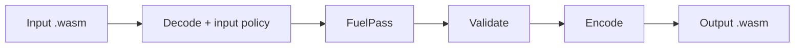

# MoonWasm FuelGuard

[](#current-status)
[](#current-status)
[](#current-status)
[](https://www.moonbitlang.com/)
[](LICENSE)

Build-time fuel metering and resource guards for MoonBit WebAssembly modules.

MoonWasm FuelGuard instruments a normal `moon build --target wasm` module with a
fixed execution budget. Function entries and loop bodies consume fuel, and an
exhausted budget traps deterministically at a reproducible point. Instrumentation
adds no imports and requires no host-side fuel API.

> FuelGuard is a resource-control tool, not a security sandbox. It does not limit
> host imports, wall-clock time, or file and network access.

## Why FuelGuard

MoonBit's primary runtime artifact is WebAssembly, but the MoonBit toolchain and
the current MoonBit hosts do not provide a portable instruction budget:

- `moon test` has no fuel or timeout option, so a runaway wasm test can stall CI.
- `moon_cove` reports source coverage; it does not impose an execution budget.
- wasm5 has no fuel support, and wasmoon's `fuel`/`budget` options are not implemented.
- Rust/C++ instrumentation tools cannot be embedded cleanly in a MoonBit build.

FuelGuard moves the budget into the module at build time. A host only needs to load
and run the instrumented wasm; it does not need to implement fuel accounting.
The goal is a portable, reproducible runtime contract, not a gas model identical
to Wasmtime.

## Current status

| Area | Status |
| --- | --- |
| Input policy | Rejects GC types, multiple memories/tables, and reserved exports |
| Decode / validate / encode | Implemented with staged errors |
| Pass API and pipeline | Fixed validation pipeline; third-party passes can be inserted |
| FuelPass | Implemented for function entries and loop bodies |
| `instrument` CLI | Implemented as a wasm-compatible, moonx-ready file pipeline |
| Real MoonBit fixture | Built, instrumented, and checked end to end |
| GuardPass | No-op without guard config; configured guards rejected explicitly |
| Native `run` adapter | Scaffold only |
| Runtime trap execution | Not verified until the wasmoon adapter lands |
| Differential corpus and benchmark | Not started |
| mooncakes release | Not published |

## Quick start

Requirements: MoonBit `0.1.20261016` or compatible, Git, and a POSIX shell.

```bash
git clone https://github.com/Atman-Angle/moonwasm-fuelguard.git
cd moonwasm-fuelguard

moon check --target wasm --deny-warn
moon test --target wasm
```

Instrument the included real MoonBit fixture:

```bash
moon run cmd/instrument --target wasm -- \
  fixtures/hello/hello.wasm \
  -o _build/hello.fuel.wasm \
  --fuel 100000
```

Expected output shape:

```text
instrumented fixtures/hello/hello.wasm -> _build/hello.fuel.wasm
  input=fixtures/hello/hello.wasm output=_build/hello.fuel.wasm fuel=100000
  passes: FuelPass, GuardPass
  note: fuel: budget=100000 functions=43 loops=21
  note: guard: disabled (no memory, table, or import limits configured)
  output bytes: 6862
```

Run the quality checks:

```bash
bash fixtures/hello/build.sh
bash scripts/check-e2e.sh
bash scripts/check-cli-failures.sh
```

Guard options such as `--max-memory-pages` are parsed, but currently rejected with
exit code `2` until GuardPass is implemented. No output file is written on failure.

## How it works

Current fuel-only pipeline:



Core invariants:

- Instrumentation never adds imports.
- Fuel is fixed at instrumentation time; there is no runtime setter.
- Every pass output is validated; the module is validated again before encoding.
- FuelPass runs before GuardPass.
- Existing function, global, type, and export indexes are preserved.
- Unsupported inputs fail explicitly; the CLI does not write partial output.

The diagnostic export is `__moonwasm_trap_code`. Trap code `1` means fuel exhaustion;
codes `2` and `3` are reserved for memory and table guards.

## CLI layout

`moonx` runs wasm packages, while wasmoon is native-only. The CLI is therefore split:

| Entry | Target | Responsibility |
| --- | --- | --- |
| `cmd/instrument` | wasm | File pipeline, moonx-compatible instrumentation |
| `cmd/run` | Linux native | wasmoon execution and trap reporting |

```bash
moon run cmd/instrument --target wasm -- --help
moon run cmd/run --target native -- --help   # Linux only
```

The native runner is currently a scaffold. Linux/WSL is the only planned runtime
environment; Windows native and wasm5 are out of scope.

## Repository layout

```text
.
├── cmd/
│   ├── instrument/        # wasm + moonx instrumentation entry
│   └── run/               # Linux native runner entry
├── runner/                # trap diagnosis and future wasmoon adapter
├── fixtures/hello/        # real MoonBit wasm fixture
├── scripts/               # e2e and CLI failure checks
├── docs/                  # requirements, architecture, task breakdown
├── ast.mbt                # private AST traversal helpers
├── fuel_state.mbt         # fuel and trap-code globals
├── fuel_pass.mbt          # fuel metering pass
├── builtin_passes.mbt     # FuelPass and GuardPass wiring
└── pipeline.mbt           # fixed validation pipeline
```

## Development

Before submitting changes:

```bash
moon info
moon fmt
moon check --target wasm --deny-warn
moon test --target wasm
moon fmt --check
```

The wasm suite currently covers configuration, input policy, AST rewriting, fuel
injection, determinism, and CLI failure behavior. The end-to-end scripts exercise
a real MoonBit `--target wasm` artifact.

Windows native tests are not supported: starshine's native trace backend uses
`gettimeofday`, which is unavailable in the current MSVC environment.

## Limitations

- Only fuel metering is implemented. GuardPass and import allowlisting are planned.
- The wasmoon runner is not implemented, so runtime trap behavior is not yet verified.
- There is no differential corpus, performance benchmark, or public package release.
- The tool does not provide instruction-level gas equivalence with Wasmtime.
- The tool is not a sandbox and does not protect against malicious host imports.

## Roadmap

- [x] Input policy, Pass API, validation pipeline, and FuelPass
- [x] Fuel-only `instrument` CLI and real MoonBit fixture
- [ ] Memory and table growth guards
- [ ] Import allowlisting and guard diagnostics
- [ ] Linux wasmoon runner and CI trap demo
- [ ] 30+ deterministic differential cases and 10 control-flow boundaries
- [ ] Fuel overhead and module-size benchmark
- [ ] mooncakes release and moonx verification

## Documentation

- [Requirements](docs/05_需求定稿_MoonWasm_Instrument.md)
- [Architecture](docs/06_架构设计_MoonWasm_Instrument.md)
- [Task breakdown](docs/07_任务分片_MoonWasm_Instrument.md)

## License

Apache-2.0. See [LICENSE](LICENSE), [NOTICE](NOTICE), and [THIRD_PARTY.md](THIRD_PARTY.md).

The project references the instrumentation ideas of
[paritytech/wasm-instrument](https://github.com/paritytech/wasm-instrument),
[Binaryen](https://github.com/WebAssembly/binaryen), and Wasmtime/Wasmer without
copying their code. Parsing, validation, and encoding are provided by
[starshine](https://github.com/jtenner/starshine-mb).
