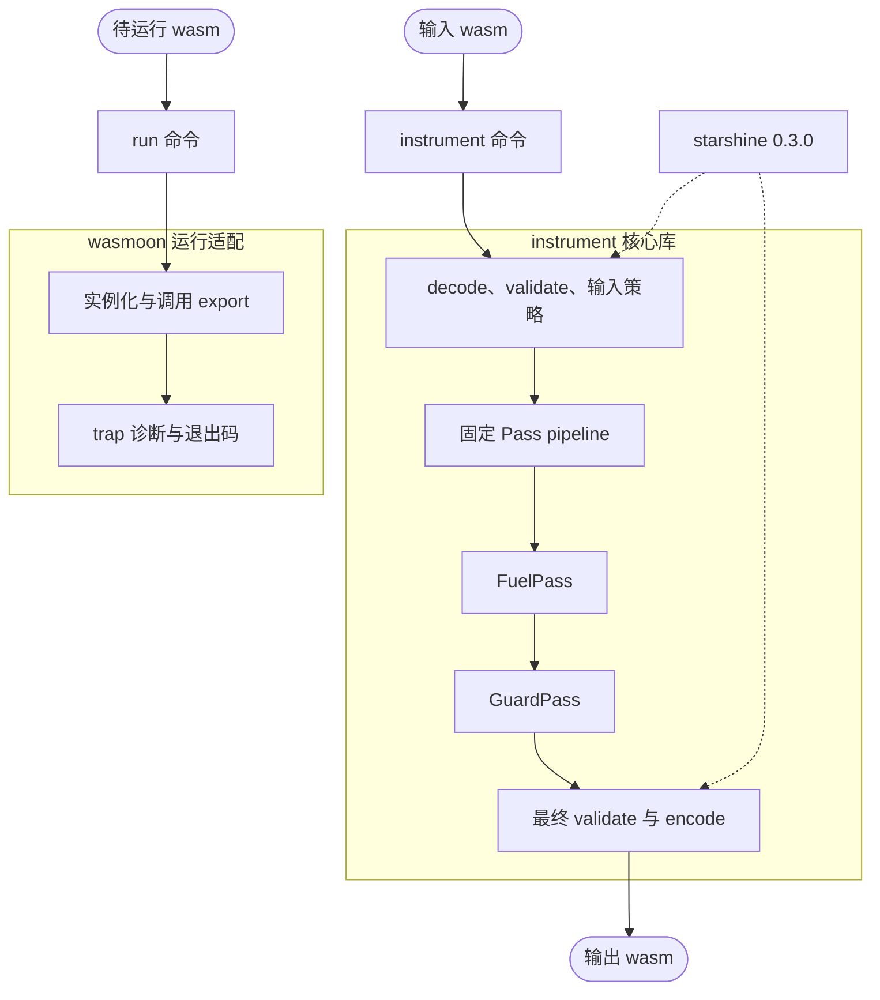
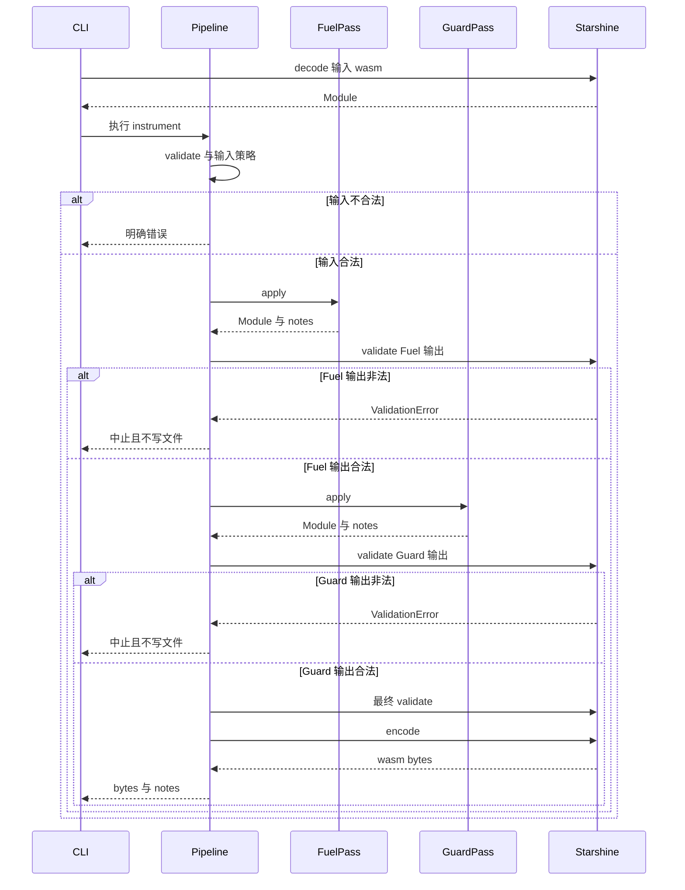
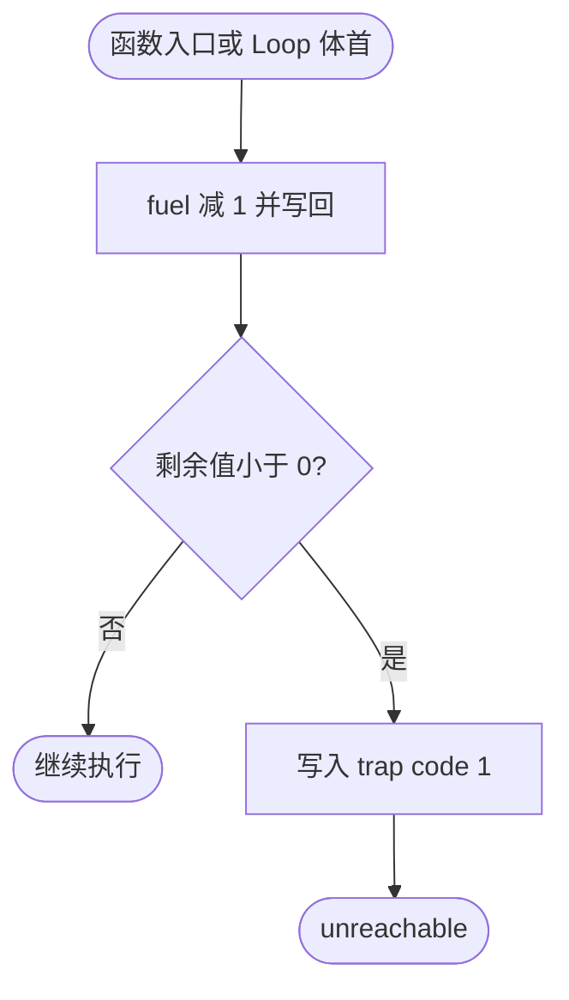
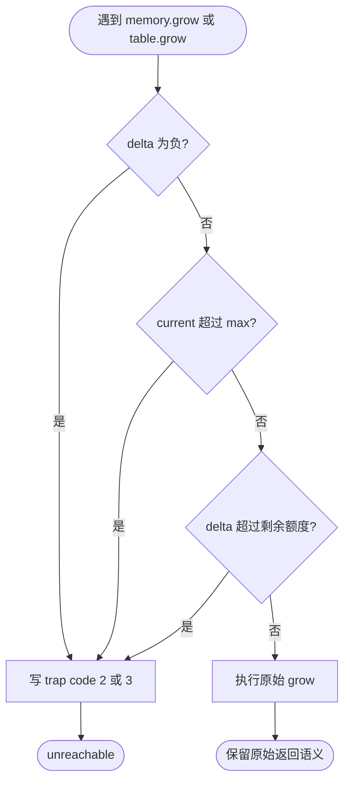
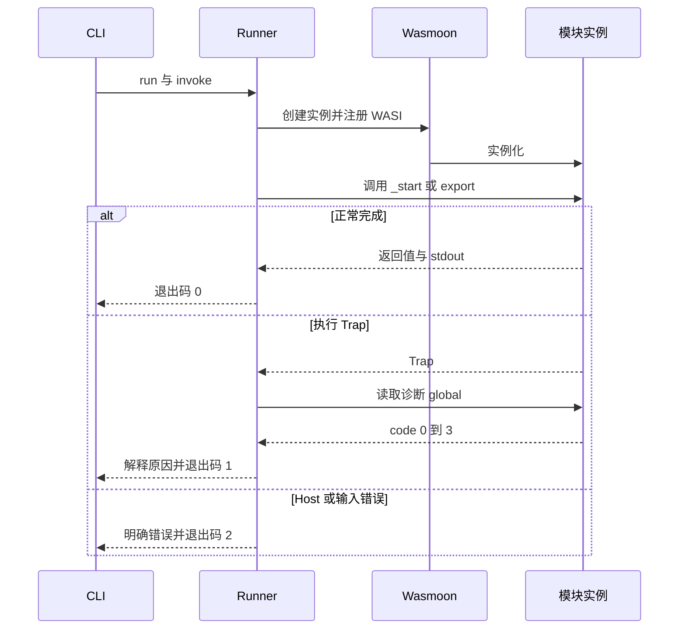

# MoonWasm Instrument 架构设计

_状态：最终方案，已完成对抗审计 · 2026-11-01 · 对应需求 v2_

---

## 1. 文档定位

本文定义 MoonWasm Instrument 首月的技术边界、模块职责、插桩语义、运行接口和验收方式，作为后续建仓与实现的直接依据。

需求来源为 [05_需求定稿_MoonWasm_Instrument.md](05_需求定稿_MoonWasm_Instrument.md)。本版已确认以下范围调整：

- 不做 Windows 原生运行。
- 不做 wasm5 验证。
- 唯一运行宿主为 Linux/WSL 中的 wasmoon `0.18.0`。
- 插桩核心保持宿主无关，但不为未支持宿主预留抽象。
- 实现仓库名为 `Atman-Angle/moonwasm-fuelguard`；产品名保持 MoonWasm Instrument。
- 因 `moonx` 只运行 wasm、wasmoon 只支持 native，CLI 拆为 wasm 的 `cmd/instrument` 与 native 的 `cmd/run`。

---

## 2. 目标与范围

### 建设内容

构建一个纯 MoonBit 的 WASM 二进制插桩库和 CLI：在构建期写入 fuel、memory/table 增长限制，输出不新增 import 的标准 WASM；运行侧只负责在 Linux/WSL 的 wasmoon 中加载、执行和解释 trap。

### 首月能力

| 能力 | 交付 |
| --- | --- |
| FuelPass | 函数入口和 Loop 体首扣费，耗尽后确定性 trap |
| GuardPass | memory/table 增长上限和 import allowlist |
| Pass API | 公开 Pass 接口、固定内置 pipeline、逐步校验 |
| CLI | `instrument` 与 `run` |
| 运行适配 | Linux/WSL wasmoon、WASI stdout、trap code 报告 |
| 验证 | 确定性差分、控制流边界、CI demo、性能基准 |

### 明确不建设

- 通用 WASM 优化器、CFG、SSA、HOT 转换或分析缓存。
- 通用索引重映射器。
- 通用 Host 抽象、宿主插件系统或备用运行时。
- 运行期 fuel setter、Trace、profiling、调用序列。
- wasm-gc、component model、多 memory/table、多模块链接。
- Windows、wasm5、浏览器、wasmtime 适配。
- JSON 配置、UI、托管服务。

---

## 3. 总体架构

架构按“宿主无关的插桩核心”和“单一运行适配”分离。CLI 只做参数、文件和退出码，不承载插桩逻辑。

_图 1：组件架构与依赖方向。插桩核心依赖 starshine，运行适配依赖 wasmoon，两者互不反向依赖。_



### 模块职责

| 模块 | 职责 | 依赖 |
| --- | --- | --- |
| `instrument` | Pass API、pipeline、输入策略、FuelPass、GuardPass | starshine |
| `runner` | 实例化、WASI、调用 export、trap 诊断 | wasmoon |
| `cmd/instrument` | wasm 兼容的参数解析、文件读写、摘要、退出码 | `instrument` |
| `cmd/run` | Linux native 的参数解析、运行和退出码 | `instrument`、`runner` |
| `tests` | 单元测试、差分语料、CI demo、基准 | 以上模块 |

依赖方向固定为 `cmd/instrument → instrument`、`cmd/run → runner → instrument`、`instrument → starshine`、`runner → wasmoon`。核心库不得依赖 wasmoon。

`cmd/instrument` 可经 moonx 分发；`cmd/run` 只构建为 Linux native。两者共享核心，不共享宿主依赖。

---

## 4. Pass pipeline

### 执行顺序

内置顺序固定为：

```text
decode
→ validate + 输入策略检查
→ FuelPass
→ validate
→ GuardPass
→ validate
→ encode 前 validate
→ encode
```

每个 pass 的输入和输出都是完整 `Module`。pipeline 在每个 pass 后立即调用 starshine 的 `validate_module`；编码前再校验一次。

### Pass 契约

公开 Pass 的语义接口为：

- 接收一个完整、已验证的 `Module`。
- 返回新的完整 `Module` 和文本 notes。
- 不原地修改输入。
- 不通过可变 Pass 实例保存本次执行报告。

notes 仅用于插桩数量、allowlist warning 等 CLI 摘要，不引入通用诊断对象、配置字典或事件系统。

第三方 pass 只能通过库 API 插入，不提供 CLI 动态注册。任何 pass 失败、返回非法模块或校验失败，pipeline 立即中止。第三方 pass 新增 import 或改变既有函数/global/type 索引不在首月保证范围内，文档只把它列为扩展点。

starshine 的 encode 会 canonicalize，输出不要求与输入 byte-identical。验收判断以 validate 和语义一致为准，不比较未改区域的字节位置。

_图 2：插桩流水线与失败边界。写出文件只发生在最终校验和编码成功之后。_



### 输入策略

在 FuelPass 前统一拒绝：

- wasm-gc、component model、多模块输入。
- 多个 memory 或 table。
- 无法 decode 或无法通过初始 validate 的模块。
- 预算、内存上限、表上限或 allowlist 参数非法。
- 导出名称 `__moonwasm_trap_code` 已存在。

输入策略与具体 Pass 分离，避免 FuelPass 和 GuardPass 重复实现同一拒绝逻辑。

---

## 5. FuelPass

### 运行期状态

FuelPass 追加两个内部 mutable global：

| 状态 | 类型 | 初始值 | 是否导出 |
| --- | --- | --- | --- |
| fuel | `i32` | 配置预算 | 否 |
| trap code | `i32` | `0` | 是，名称固定为 `__moonwasm_trap_code` |

fuel 是**实例生命周期预算**。同一实例多次调用 export 时预算累计消耗，不会在每次调用前自动恢复。需要独立预算的测试必须创建新实例。

采用需求允许的 exported global 方案：它使 Guard 能通过固定 export 找到诊断状态，不引入额外 pipeline context 或 getter 函数。

“只读诊断”是宿主使用契约。标准 WASM 中 exported mutable global 技术上可被宿主写入，本项目不把它当作安全边界，也不承诺宿主不可篡改。

### 扣费语义

- 预算必须大于 0 且不超过 `i32` 上限。
- 只对输入模块已有的已定义函数扣费。
- 每个已定义函数入口扣 1 单位。
- 每个 Loop 体开始扣 1 单位，包括首次进入和每次 continue。
- 导入函数没有函数体，不扣费。
- 宿主 import 的副作用和执行时间不计入 fuel。
- 先减 1，再检查剩余是否小于 0。
- 不足时先写 trap code `1`，再执行 `unreachable`。
- FuelPass 追加的 global 不扣费。
- GuardPass 随后追加的 helper 不扣 fuel。

_图 3：单次 fuel 扣费路径。正常路径一次读取、一次写回 fuel global。_



### 热路径实现

扣费指令直接内联到每个扣费点，不调用 charge helper。每个已定义函数末尾追加一个 `i32` local，供该函数所有扣费点复用。

正常扣费路径只包含：

- 一次 fuel global 读取；
- 一次 fuel global 写回；
- 一次负数分支；
- 无额外函数调用。

追加 local 位于已有 local 声明之后，不改变参数和旧 local 索引。trap 分支额外写一次 trap code global，该成本只发生在终止路径。

内联是首版减少正常路径调用的选择，不预设它在所有引擎上必然快于 helper。若固定基准超过 3x 软目标，再做共享 charge helper 对照实验，不提前维护两套实现。

### 复杂度

- 只遍历一次指令树。
- 指令数线性复杂度。
- 预分配并重建输出数组，避免反复拼接。
- 不做 FuelPass 内部的 decode/encode 往返。

---

## 6. GuardPass

### 增长保护

memory 和 table 各使用一个末尾追加的本地 helper。原始 grow 指令改写为 helper 调用：

- memory helper 接收 delta，返回 `i32`。
- table helper 同时接收原始初始化引用和 delta，返回 `i32`。
- table helper 的操作数顺序与原始 `table.grow` 一致。
- table helper 的引用参数类型必须匹配目标 table 的元素类型。

若函数类型 section 中没有完全匹配的签名，GuardPass 追加一个新 type；已有 type 索引不变。

未配置某项上限时不生成对应 helper，也不改写该指令。

### 溢出安全判断

不直接计算 `current + delta`，而使用以下顺序：

1. `delta < 0`：失败。
2. `current > max`：失败。
3. `delta > max - current`：失败。
4. 通过则调用原始 grow。

第二项同时覆盖宿主已从外部扩大 memory/table 的情况，并保证后续减法不会下溢。Guard 仍不是安全隔离，不限制宿主 import、已分配内存内的访问或未被插桩的代码。

_图 4：memory/table 增长保护。失败路径分别写入 trap code 2 或 3。_



### 语义边界

- 上限内的 grow 保留原始行为，包括底层失败返回 `-1`。
- 超限时不再返回 `-1`，而是确定性 trap。
- 初始 memory 页数或初始 table 元素数超过配置上限时，在插桩阶段拒绝。
- 不修改 memory/table 的声明上限。
- 不新增 import。

### Import allowlist

- 覆盖 func、memory、table、global 四类 import。
- 精确匹配 `module.name`，不支持通配符。
- 未提供 allowlist 时不过滤。
- 未使用的 allowlist 项按参数顺序产生 warning。
- 非 allowlist import 在改写前拒绝。

---

## 7. Trap 与运行适配

### Trap code

| code | 含义 |
| --- | --- |
| `0` | 无 fuel/guard trap；运行时按模块自身 trap 报告 |
| `1` | fuel 耗尽 |
| `2` | memory 增长超限 |
| `3` | table 增长超限 |

`run` 在 trap 后读取 `__moonwasm_trap_code`。若导出缺失，按模块自身 trap 报告；若取值未知，报告无效诊断，不映射为成功。

### wasmoon runner

Runner 是唯一宿主适配层：

- 固定 wasmoon `0.18.0`。
- 只支持 Linux/WSL。
- 注册 WASI 并继承 stdout。
- 默认调用 `_start`。
- `--invoke` 只接受无参导出函数。
- 每次 `run` 创建新实例。
- 捕获结构化 `Trap`、`TimedOut` 和 `Cancelled`。
- 正常完成时输出结果并退出 `0`。
- 执行 trap 时解释 trap code 并退出 `1`。
- 参数、输入、校验、插桩或宿主配置错误时退出 `2`。

_图 5：运行与 trap 诊断。trap 后实例仍可读取诊断导出。_



不定义通用 Host trait。新增宿主需要重做需求评审，而不是通过配置开关接入。

---

## 8. CLI 契约

### instrument

```text
moonx Atman-Angle/moonwasm-fuelguard/cmd/instrument <in.wasm> -o <out.wasm> \
  --fuel <N> \
  [--max-memory-pages <N>] \
  [--max-table-elements <N>] \
  [--allow-import <module.name>]...
```

行为：

1. 解析参数并做范围检查。
2. decode 输入并执行输入策略。
3. 按 FuelPass、GuardPass 顺序执行。
4. 每个 pass 后 validate。
5. 最终 validate 后 encode。
6. 成功后才写出输出文件。

成功摘要包含预算、上限、allowlist、函数数、循环数和 pass 顺序。任一阶段失败均以非零码退出，不留下半成品。

### run

```text
moon run cmd/run --target native -- <in.wasm>
moon run cmd/run --target native -- <in.wasm> --invoke <export>
```

正常完成输出结果并退出 `0`；trap 输出 code、原因和退出码 `1`；输入或宿主错误退出 `2`。

---

## 9. 性能与验证

### 性能和体积

运行时开销主要来自燃料扣费和 Guard helper。首版策略是：

- 扣费点内联，正常路径无函数调用。
- Guard 只在 grow 冷路径增加一次 helper 调用。
- 插桩时间保持指令数线性。
- 不引入 CFG、SSA、HOT lift/lower 或分析缓存。

固定三个 fuel-only 基准：函数调用密集、循环密集、调用/循环混合。测量条件：

- 原模块与插桩模块使用相同 wasmoon 配置。
- fuel 足够，测量期间不 trap。
- 排除编译时间，每个样本使用新实例。
- 预热 2 次，取 7 次测量中位数。
- 同时记录 `.wasm` 字节数变化。

运行时间比和代码体积变化写入 README 与验收报告。`≤3x` 是软目标；超过时不阻塞交付，但必须解释根因并先尝试共享 charge helper。

### 正确性矩阵

| 类别 | 用例 |
| --- | --- |
| Fuel 边界 | 精确预算、差 1 耗尽、充足预算、预算为 0 被拒绝、超过 i32 上限被拒绝 |
| 控制流 | 嵌套循环、首次进入、continue、提前跳出、`br_if`、`br_table`、`call_indirect` |
| 索引 | imported function/global、已有参数和 local、已有 type 和 export |
| Guard | 负 delta、零增长、恰好上限、超过上限、初始超限、底层返回 `-1` |
| Table | 初始化引用保持不变、引用类型正确、操作数顺序正确 |
| Import | 四类 import allowlist、精确匹配、未使用 warning |
| 拒绝路径 | GC、component、多 memory/table、非法模块、导出名称冲突 |
| Pipeline | 第三方 pass 输出非法模块时被拒绝、失败时不写文件 |
| 差分 | 至少 30 个确定性用例、10 个控制流边界、0 个未解释差异 |

差分比较 stdout、返回值、正常 trap 和 fuel trap code。fuel 中途 trap 时只比较 trap code 与确定性输出前缀。WASI clock、random、network、env 等非确定输入不进入差分语料。

### 主场景验收

真实 MoonBit `--target wasm` 模块可在 Linux/WSL 的 wasmoon 中运行；正常输入结果与原始模块一致；死循环在固定 fuel 点触发 code `1`；失控内存增长触发 code `2`；CI 以非零码失败并可复现。

---

## 10. 前提、风险与决策

### 依赖与前提

| 项 | 约束 |
| --- | --- |
| 仓库 | `Atman-Angle/moonwasm-fuelguard` |
| MoonBit | 已安装，实测版本 `0.1.20261016` |
| starshine | 固定 `0.3.0` |
| wasmoon | 固定 `0.18.0`，仅 Linux/WSL |
| 运行环境 | 当前本机只有 `docker-desktop` WSL 分发，验收环境待准备 |
| 凭据 | 无 API key、第三方账号或在线服务 |

### 主要风险

最脆弱的假设是 **Linux/WSL 中的 wasmoon 能端到端运行真实 MoonBit WASI 模块**。如果该假设不成立，`run` 和 CI demo 会被阻塞，但 Fuel/Guard、Pass API、validate/encode 和核心差分不受影响。

不采用 HOT pipeline，因为其 pass 分派以内置静态表为主，不适合接入自定义 Pass[^1]。不照搬成熟 metering 的复杂度，但保留“单一 fuel 状态”和“本地 helper 不新增 import”的机制[^2]；Guard 的参数前置判断参考 grow 指令包装思路，不引入其全内存跟踪能力[^3]。

### 关键决策

| 决策 | 选择 | 主要理由 | 拒绝的替代 |
| --- | --- | --- | --- |
| AST 使用方式 | 直接遍历 starshine 原始 AST | 规则少、线性、无需 lift/lower | HOT pipeline、CFG、SSA |
| 扣费实现 | 扣费点内联 | 正常路径无函数调用 | 每点 helper、按块计费 |
| 诊断导出 | exported mutable global | Guard 可直接定位，最少状态传递 | getter 函数、pipeline context |
| Grow guard | 共享本地 helper | 冷路径调用成本可接受、减少代码膨胀 | 每点内联 guard |
| Pass 组合 | 固定 Fuel→Guard | 语义依赖明确、校验边界清晰 | 动态插件注册 |
| 运行宿主 | 单一 wasmoon runner | 符合已确认范围 | Host 抽象、wasm5、Windows 原生 |

### 参考

- [MoonWasm Instrument 需求定稿 v2](05_需求定稿_MoonWasm_Instrument.md)
- [wasmoon 0.18.0](https://github.com/Milky2018/wasmoon)
- [starshine v0.3.0](https://github.com/jtenner/starshine-mb/tree/v0.3.0)
- [paritytech/wasm-instrument gas metering](https://github.com/paritytech/wasm-instrument/tree/master/src/gas_metering)
- [Binaryen InstrumentMemory](https://github.com/WebAssembly/binaryen/blob/main/src/passes/InstrumentMemory.cpp)

[^1]: starshine. "Pass manager and HOT pipeline." v0.3.0. https://github.com/jtenner/starshine-mb/blob/v0.3.0/src/passes/pass_manager.mbt

[^2]: Parity Technologies. "Gas metering backend." wasm-instrument. https://github.com/paritytech/wasm-instrument/tree/master/src/gas_metering

[^3]: WebAssembly Binaryen. "InstrumentMemory pass." https://github.com/WebAssembly/binaryen/blob/main/src/passes/InstrumentMemory.cpp
