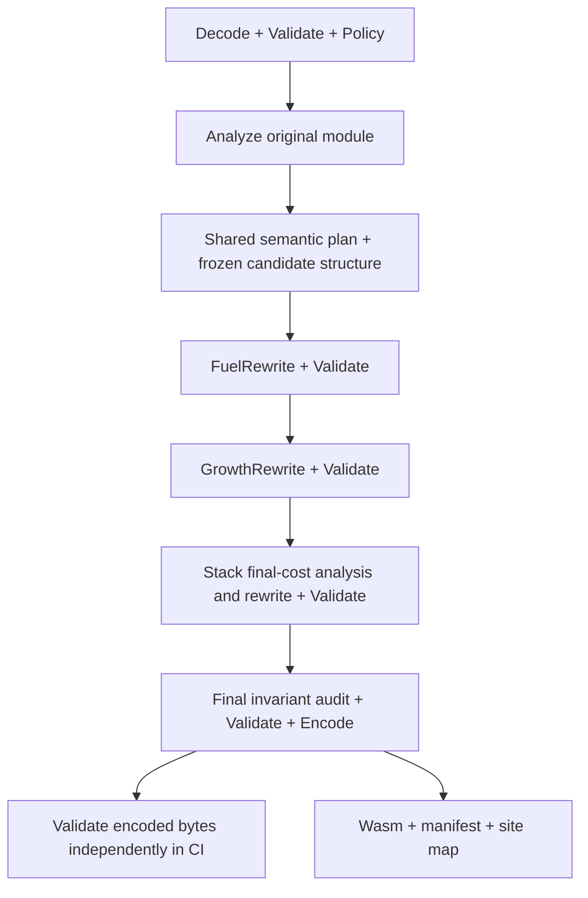

# MoonWasm FuelGuard 架构设计 v3

> **已归档（2026-11-20）：**本文被 [14 FuelGuard 生产规格 v4](14_FuelGuard生产规格_v4.md) 取代，仅作历史设计记录留存；与 14 冲突之处以 14 为准。

状态：生产级目标设计，待实现与门禁验证。日期：2026-11-10。
本版替代 2026-11-01 架构；不代表现有代码已符合本版。需求见 [05](05_需求定稿_MoonWasm_Instrument.md)，验收见 [09](09_验证与验收计划.md)。

## 1. 架构边界

本项目实现规范由本文和 [FuelGuard高性能实现方案](12_FuelGuard高性能实现方案.md) 共同组成：本文定义架构不变式，12定义数据结构、算法和代码生成。参考项目不定义本项目默认实现，不替代自主算法或验收。

FuelGuard用MoonBit自行实现分析、计费、Stack/Growth、布局与报告。starshine提供解析/校验/编码，运行时提供执行；不调用wasm-instrument或Binaryen完成产品插桩。

instrument 核心仅依赖解析/验证/编码库；cmd/instrument 负责文件与参数且保持 wasm/moonx 兼容。runner/cmd/run 仅 Linux native，拥有 wasmoon 适配。Wasmtime 驱动属于 integration，不进入核心或公开运行入口。

当前 moon.mod 只声明 starshine 0.3.0；wasmoon 0.18.0 是待验证适配候选。实现时固定实测 MoonBit、依赖和 Wasmtime 版本及锁定信息，不将历史版本记录当成兼容证明。S01 已冻结的特性允许表、六项覆盖状态与输入上限见 [支持矩阵](implementation/support-matrix.md)，实测开发环境、PENDING 认证字段、模型/ABI 版本与迁移规则见 [环境锁定](implementation/environment-lock.md)。

## 2. 分阶段流水线

旧 Fuel→Guard 顺序升级为显式 Fuel→Growth→Stack。Stack 最后处理，确保 local、helper 与包装开销计入预算。费用分析只针对原始指令；生成节点带来源标记，防止二次计费。每次修改完整 Module 后验证，编码前再验证；编码后字节在独立验证器及两个引擎中验收。

计划分为三个不可变阶段对象：共享 SemanticPlan 保存支持特性、原始函数映射、canonical 计费块、动态操作、site、费用及统一栈模型；每候选 InstrumentPlan 保存确定的追加类型/函数/global/local、签名、索引、模板及包装结构；最终 StackLayout 保存实际成本上界与核验结果。Fuel/Growth 生成前冻结候选结构，Stack 阶段仅计算和填入常量，不再改变数量、签名或引用布局。需要改变结构时显式重新规划，不原地修补旧计划或无限迭代成本。Pass 不借可变实例传递隐式状态。原始 AST 数组不得原地修改。

已有函数/global/type 的数值索引保持稳定；允许追加项目，允许有计划地改写 export/start/element 的目标引用。所有引用改写有清单和独立完整性测试。生产 pipeline 拒绝未知第三方变换，实验性 Pass API 单独标识。

## 3. 高性能 Fuel 实现

### 计费块分析

使用结构化控制流和显式工作栈遍历，建立必要的控制流边界，不引入通用 SSA。标量指令按冻结权重求和。分支目标、循环回边、条件分支、调用、动态操作和可观察副作用采用保守分割。不得把循环费用外提、把条件分支费用计入未执行分支，或跨可能 trap 的边界任意搬移扣费。

费用模型定义 canonical site 与预扣顺序；优化版本不得改变预算耗尽位置或输出前缀。跨块合并只有在证明对全部预算保持该契约时才能启用；否则属于新模型版本。先测内联与 helper 布局，避免以改变语义换取速度。

保守划分不等于单指令计费；无 trap、无可观察副作用的必经前缀可与末尾边界指令合并。边界表在费用模型中精确定义并冻结，P0/P1/P2 只改变生成布局，共用同一计费计划，不默认增加 load/store 或 helper 处的检查。

### 扣费代码生成

首个候选P0采用块入口内联：读取一次fuel并与已检查成本比较；不足时在内联失败分支写code/site并unreachable；足够时减法并写回一次。P0不调用额外失败helper。P1共享charge与P2静态混合布局由本项目实现并对照测试；候选新增调用一律计入栈成本，不能让错误处理先栈溢出。

不用逐条指令插入计费调用，不用生产热路径日志，不在生产中同时运行两套计费器。静态成本为零的节点允许存在，但所有无限执行环必须经过正成本计费点，分析和反例测试共同验证。

Fuel 使用 i64；动态成本 a+b*n 先检查范围再乘加，n 由 unsigned 操作数拓宽；拒绝无费用规则的操作。动态参数用追加 local 保存一次，保持原始求值与操作数顺序。块费用累加在构建期也检查溢出。

### 优化选择

比较本项目P0纯内联、P1共享helper、P2静态混合策略，具体数据结构和选择流程见12。production 输出采用跨认证引擎表现最稳的确定性策略，禁止运行时自适应造成产物不可复现。不假设内联总是最快。有限候选布局计入优化搜索；每个候选先过语义测试再跑性能。

## 4. Growth 与导入策略

输入策略首先检查 import、资源类型/初始容量和生产特性清单。allowlist 内部保存 module/name 二元组；CLI 的点号写法遇到歧义必须拒绝或提供明确转义，不允许字符串拼接碰撞。

memory/table grow 优先共享本地 helper，保持引用类型和原始参数顺序。按 unsigned delta 检查 current>limit 或 delta>limit-current；失败 code 2/3。通过资源检查后收动态费用，再调用原 grow，底层返回 -1 不退费。memory.copy/fill/init、table copy/fill/init 等只有在支持清单允许且动态计费完整时可接受。

production-v1 的 funcref table 固定、内部、不导入导出，只允许静态受控引用；拒绝运行期变更和逃逸，避免间接调用绕开栈包装。externref table 不参与调用目标解析，可按受测指令集增长。可变 funcref table 支持是后续设计，不得静默接受。

## 5. Stack 实现与关键风险

分析每个函数的 typed operand stack 峰值、参数/local 数和固定帧成本；处理 unreachable 的栈多态与 multi-value 分支。v128 local 与 v128 操作数栈值按 16 字节保守计入，不得按 i32 等价估算；真实 MoonBit 负载已实测含 v128 签名与数十个 v128 local。采用经过独立样例验证的保守上界，不能靠扫描 push/pop 猜测。原函数加上已生成 Fuel/Growth 代码后重新分析；栈插桩自身增加的 local、wrapper 和冷失败路径通过模板上界纳入最终费用。

区分统一预算成本 C(f) 与布局实际成本上界 A(layout,f)。C 由版本化模板族定义，与默认布局选择无关；每候选在构建期证明 A <= C，运行期仅使用 C 常量。按同时活跃关系合成成本：顺序/互斥辅助路径取最大值，嵌套辅助链、挂起 caller 与 callee 相加。跨原函数调用仍存活的间接 wrapper 不得作为已结束的临时开销丢弃，其成本归属须在计划中唯一标识。

原始直接 call 前预留被调函数成本并检查深度，正常返回后释放。所有返回值在栈上保持，计数操作必须栈平衡。export、start 和 element 指向追加 wrapper；wrapper 在进入原始函数前检查，直接调用原函数时不重复套 wrapper。外部入口 wrapper 的自身帧和每层间接 wrapper 都计入保守开销及引擎余量。禁止单靠被调函数入口检查，因为原生帧可能已分配。

上述预算检查对应原始逻辑调用；已被统一成本覆盖的生成 helper/wrapper 不另加用户深度或现场预算检查。helper 的额外物理调用开销仍按布局计入 A 和性能测量。进入间接 wrapper 前的临时余量由调用者已预留范围覆盖；最外 export/start wrapper 的自身入口由受测引擎入口余量覆盖，不能靠进入 wrapper 后扣计数证明其入口安全。错误顺序以需求 05 为准。

模板结构应先固定再计算成本；若选择了不同 helper/内联策略，重新建立候选结构计划并验证，禁止无限迭代估计。对所有包装函数和生成 helper 进行覆盖审计，检查诊断冷路径也有余量。

抽象预算不是原生字节保证。认证记录引擎版本、原生栈配置、线程栈及最坏大帧/递归探针；未测范围拒绝标为生产支持。host import 的栈使用/重入不受模块计数覆盖，runner 禁止重入，其他宿主必须遵守契约。

原生栈认证需给出受管代码和生成模板的保守映射依据，冻结参数/返回值/local/嵌套规模及入口余量；测试用于反证和验证上界。无法建立依据的输入或配置不进入生产范围。宿主内部栈、I/O 和墙钟仍由宿主负责。

trap 后不执行减计数逻辑；runner 读取可用诊断后销毁 Store/instance。正常返回后的再次 export 调用可以保留 Fuel 累计预算，但栈计数必须回到入口基线。start trap 若拿不到实例，输出诊断不可用，不能伪造 code。

## 6. 诊断、文件与兼容性

内部 fuel、stack、depth global 不导出；诊断导出保持旧 __moonwasm_trap_code，新增 site ID 并标记 ABI 版本。成功路径不逐点写 site；失败时写入。code 0..5 定义见需求，未知值为诊断错误。诊断是可信宿主协议，不是不可篡改证明。

manifest 包含输入/输出 SHA-256、工具/费用模型/栈模型/ABI/profile/codegen 版本、配置、追加项目、site 映射、特性清单。静态 manifest 不写“测试通过”；测试结果单独引用输出哈希。custom section 可存模型标记，最终产物哈希放 sidecar，避免自引用。重复插桩明确拒绝。

CLI 在成功编码后写同目录临时文件，完成校验再发布；默认拒绝覆盖现有目标。多文件提交以最后写入的 manifest 为完成标记，消费者验证哈希；中途失败不得留下可被识别为完整交付的组合。报告路径冲突、输入等于输出、权限失败、磁盘满均有测试。不同文件之间不声称存在文件系统原子事务。

现有 CLI/API 属粗粒度原型；新 i64 配置、默认 import 策略、pass 顺序及诊断 ABI 属不兼容变化，发布新 minor 版本并提供迁移说明。旧产物仍按其模型版本解释，不能标注为 fuel-v1。

## 7. 性能与生产发布

主要指标是相同配置下原模块对完整保护模块的业务生命周期时间比、适用负载的热调用时间比、尾延迟和体积。生命周期覆盖实例化（包含 core start section 的用户执行）及显式业务入口；不得用空导出调用替代 start 中的计算。热调用不含实例化，用于相应负载及归因。两个窗口分别执行 09 的性能门槛，不能混合抵消。Fuel-only、解析、分析、各次 validate、编码、引擎编译及端到端成本另报。

P0/P1/P2 的参数、选择规则和默认布局在调优集上冻结，最终独立验收集只作达标确认；可报告其他候选对照数据，但不得据此更换默认后继续宣称独立验证。失败后如需重新调优，保留旧结果，另建独立确认集。

[09](09_验证与验收计划.md) 定义硬性发布预算。持续缓存仅缓存不可变静态分析，键包含输入哈希、工具版本、配置与模型；不共享运行期预算或实例。首版先用线性重建、预分配和避免 AST 往返，不提前引入磁盘缓存或复杂优化。

## 8. 依据与限制

- [wasm-instrument 计费实现](https://github.com/paritytech/wasm-instrument/blob/master/src/gas_metering/mod.rs)：计费块、预扣及动态费用的参考。
- [wasm-instrument 栈限制](https://github.com/paritytech/wasm-instrument/blob/master/src/stack_limiter/mod.rs)：调用前检查、wrapper 和 trap 后计数失配风险。
- [Wasmtime 中断语义](https://docs.wasmtime.dev/examples-interrupting-wasm.html)：Fuel 与 epoch 的确定性区别。

以上是设计参考，不是本项目实现证据，也不直接复制代码。引用上游具体实现时应在实现任务中固定 commit。S01 已用四个真实产物核实输入特性（单 memory、内部固定 funcref table + call_indirect、bulk memory copy/fill、真实 start section、WASI 函数 import、16 条 SIMD 指令与 v128 类型），解析与独立验证均通过；S25 起该 SIMD 子集按申报书收敛为全部拒绝，负载以标量实现重建。仍未验证的最大风险：栈模板与 v128 成本上界的完整性、Linux 认证环境可用性、两个引擎上的完整保护开销。

成熟项目的参考依据及不适用边界见 [10](10_成熟项目参考与性能决策.md)。插桩后优化会使原栈成本、site映射与manifest认证失效，必须重新验证；不能仅凭二进制validate通过沿用旧保证。
