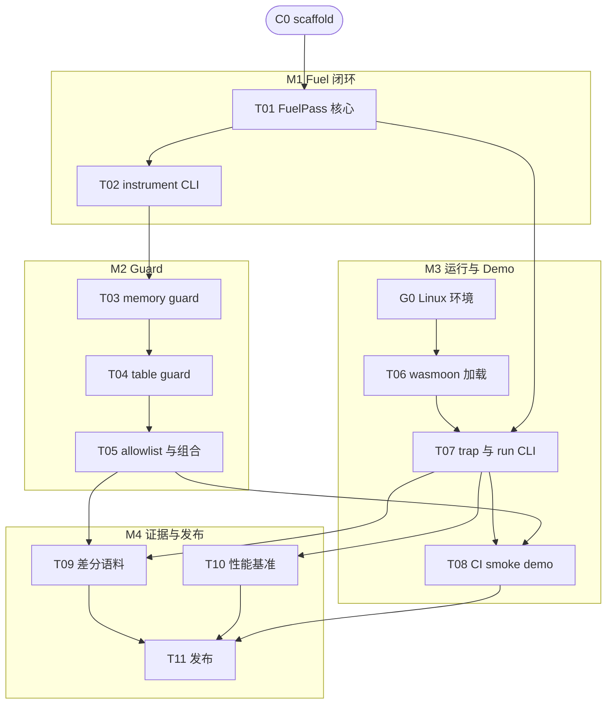

# MoonWasm Instrument 任务分片

_状态：执行计划 v1 · 2026-11-01 · 仓库：Atman-Angle/moonwasm-fuelguard_

---

## 1. 目标与完成标准

本计划把已冻结的架构拆成 11 个实现分片。每个分片对应一个可独立评审的 commit，加上已完成的脚手架 commit，共 12 个有意义提交，满足赛事对 commit 数量的最低要求。

整体完成标准：

- `cmd/instrument` 能处理真实 MoonBit `--target wasm` 产物，输出通过 starshine 校验。
- Fuel 在函数入口和 Loop 体首扣费，耗尽时以 code `1` 确定性 trap。
- memory/table 增长受上限约束，分别以 code `2` / `3` trap；初始超限在插桩阶段拒绝。
- import allowlist 在插桩阶段生效。
- Linux 原生 `cmd/run` 通过 wasmoon 执行模块、读取 trap code、给出非零退出码。
- 至少 30 个确定性用例和 10 个控制流边界完成原/插桩差分。
- 一个失控测试在固定 fuel 点失败，并有可复现命令。
- 发布到 mooncakes，wasm instrumentation 入口可通过 moonx 运行。
- README、验收证据和性能结果不包含未验证能力。

明确不在本计划内：

- Windows 原生运行、wasm5、浏览器、wasmtime。
- wasm-gc、component model、多 memory/table、多模块链接。
- Trace、profiling、运行期 fuel setter、通用索引重映射。
- 通用 Host trait、插件注册表、JSON 配置或 UI。

---

## 2. 执行规则

### 提交规则

- 一个分片一个 commit，提交信息使用 `feat:`、`test:`、`perf:` 或 `chore:`。
- 每个 commit 必须同时包含实现和对应测试；纯文档分片除外。
- 每个 commit 前执行以下基线命令：

```bash
moon info
moon fmt
moon check --target wasm --deny-warn
moon test --target wasm
moon fmt --check
```

- 涉及运行适配的 commit 还要在 Linux 执行：

```bash
moon check --target native --deny-warn
moon test --target native
```

- 不允许提交“暂时漏掉 Loop”或“暂时漏掉 table”的默认路径。功能未覆盖的配置必须在 CLI 或 Pass 入口明确报错。
- 所有插桩输出在写入文件前完成最终 validate 和 encode；失败不覆盖已有输出。

### 范围与接口约束

- 插桩核心只依赖 starshine，不依赖 wasmoon 或文件系统 CLI。
- `cmd/instrument` 保持 wasm 兼容，文件 I/O 使用 `jtenner/starshine/fs`。
- `cmd/run` 只支持 Linux native，使用 wasmoon `0.18.0`。
- FuelPass 固定先于 GuardPass；每个 pass 后 validate。
- 不在任务执行中扩展支持矩阵。发现 API 差异时调整实现，不改变产品范围。

### 规模与依赖

实现会涉及超过 8 个文件，主要新增 `fuel_pass.mbt`、`guard_pass.mbt`、CLI 解析文件、runner 和集成测试；不新增服务、凭据或外部账号。

| 代号 | 分片 | 规模 | 主要依赖 |
| --- | --- | --- | --- |
| C0 | 脚手架 | 已完成 | — |
| T01 | FuelPass 核心 | L | C0 |
| T02 | instrument CLI 与 fuel-only 闭环 | M | T01 |
| T03 | memory.grow guard | M | T02 |
| T04 | table.grow guard | M | T03 |
| T05 | import allowlist 与 Guard 组合 | M | T04 |
| G0 | Linux 运行环境 | S | 无代码依赖 |
| T06 | wasmoon 加载与 WASI | L | G0 |
| T07 | trap 诊断与 run CLI | M | T01、T06 |
| T08 | CI 固定点 trap demo | S | T02、T05、T07 |
| T09 | 确定性差分语料 | L | T05、T07 |
| T10 | 性能与体积基准 | M | T07 |
| T11 | mooncakes 与 moonx 发布 | S | T08、T09、T10 |

---

## 3. 关键路径与依赖

G0 可与 T01-T05 并行准备。代码实现按单开发者串行顺序执行；T09 的 fixture 可以在 T05 后开始准备，但必须在 T07 完成后才能做跨宿主运行对照。

_图 1：任务依赖与四个交付里程碑。M1 结束时已经存在可用的 fuel-only 工具；后续里程碑只增加能力，不推翻已有接口。_



### 里程碑

| 里程碑 | 包含分片 | 交付结果 | 退出条件 |
| --- | --- | --- | --- |
| M1 | T01、T02 | Fuel-only 插桩工具 | 真实模块可插桩、校验并生成 fuel-only 模块；运行态 trap 由 M3 验证 |
| M2 | T03-T05 | 完整 Guard 能力 | memory/table 超限和 import allowlist 均按规格工作 |
| M3 | G0、T06-T08 | Linux 运行与 CI demo | wasmoon 可执行真实模块，固定 fuel 点 trap 可复现 |
| M4 | T09-T11 | 验收证据与公开发布 | 差分、性能、打包和 moonx 证据齐全 |

如果 M3 的宿主假设失败，core 与 M1/M2 仍可交付；不得用伪造的跨宿主或运行时结果替代 M3。

---

## 4. M1：Fuel 闭环

### T01 FuelPass 核心

状态：未开始

提交：`feat: implement fuel metering pass`

改动：

- 新增 `fuel_pass.mbt` 和必要的 AST 重写内部工具。
- 实现 `FuelPass`，替换当前的 `NotImplemented` 行为。
- 在 `instrument_wbtest.mbt` 增加 Fuel 单元测试和合成模块构造器。

实现要求：

- 追加 fuel 和 trap code 两个 mutable `i32` global。
- 导出 `__moonwasm_trap_code`；导出冲突由输入策略拒绝。
- 只处理输入模块中已有的已定义函数，不处理 import。
- 在函数入口和每个 `Loop` 体首插入一次扣费。
- 每个已定义函数追加一个 `i32` local；索引包含参数数量并位于旧 local 之后。
- 正常路径只访问 fuel global 一次读、一次写，不在扣费点调用 helper。
- 先减 1，再判断小于 0；不足时写 trap code `1` 后 `unreachable`。
- 复制被修改的数组，不原地修改源 `Module`；通过 `Module::with_*` 重建 section。
- 返回函数数、循环数和最终预算等 notes。

验收：

- 函数入口、单层循环、嵌套循环和 continue 路径均包含扣费点。
- 带 import function/global 的模块索引偏移正确。
- 带参数、已有 local 和已有 global 的模块不发生索引破坏。
- 插桩前后源 `Module` 不被修改。
- 每个输出模块通过 `validate_module`，并且没有新增 import。
- 无循环函数、空函数、递归函数和只含 import 的模块不 panic。

验证：

```bash
moon check --target wasm --deny-warn
moon test --target wasm
moon fmt --check
```

### T02 instrument CLI 与 fuel-only 闭环

状态：未开始

提交：`feat: add instrument CLI pipeline`

改动：

- 新增 `cmd/instrument/cli.mbt`，把 `main.mbt` 缩减为参数入口和退出码。
- 在 `cmd/instrument/moon.pkg` 增加 `jtenner/starshine/fs`。
- 更新 `builtin_passes.mbt`：GuardPass 在未配置任何 guard 时原样返回并记录 note；配置 guard 时明确返回未支持错误。
- 新增 `testdata/hello/` 真实 MoonBit 模块及构建产物，作为 CLI 端到端输入。
- 增加 CLI 单元测试和 wasm 端到端测试。

实现要求：

- 支持 `--fuel`、`-o`、`--max-memory-pages`、`--max-table-elements`、重复 `--allow-import`。
- 缺少必填参数、未知参数或重复冲突参数时退出 `2`。
- 读取输入 wasm，执行 `decode_checked → Pipeline → encode_wasm`。
- 只在 encode 成功后写入输出文件。
- 成功摘要输出预算、函数数、循环数和 pass 顺序。
- 本阶段若出现 guard 配置，明确拒绝且不写文件。

验收：

- 真实 MoonBit 模块可生成 fuel 插桩文件，输出通过 validate。
- 缺失输入、非法预算、非法上限、不可解码输入均无输出文件。
- 同一输入运行两次得到相同摘要和一致编码结果。
- `--fuel` 缺失时不会使用隐式默认值。

验证：

```bash
moon check --target wasm --deny-warn
moon test --target wasm
moon run cmd/instrument --target wasm -- testdata/hello.wasm -o _build/hello.guarded.wasm --fuel 100000
```

---

## 5. M2：Guard

### T03 memory.grow guard

状态：未开始

提交：`feat: guard memory growth`

改动：

- 新增 `guard_pass.mbt`。
- 实现 memory grow helper、type 追加和 memory 初始上限检查。
- 在 `instrument_wbtest.mbt` 增加 memory guard 测试。

实现要求：

- 每个 `memory.grow` 改写为本地 helper 调用。
- helper 拒绝负 delta、`current > max` 和 `delta > max - current`。
- 超限写 trap code `2` 后 `unreachable`。
- 未超限时调用原始 `memory.grow`，保留底层失败返回 `-1`。
- 初始 memory 页数超过上限时拒绝插桩。
- 不改写 table.grow；若用户配置 table 上限，CLI 明确拒绝。
- Guard helper 不扣 fuel。

验收：

- delta 为 `-1`、零、恰好达到上限、超过上限均符合规格。
- 初始内存超限在插桩阶段失败。
- 原始 grow 在预算内失败时仍返回 `-1`。
- 输出通过 validate，新增 helper 不影响既有函数索引。

验证：

```bash
moon check --target wasm --deny-warn
moon test --target wasm
```

### T04 table.grow guard

状态：未开始

提交：`feat: guard table growth`

改动：

- 扩展 `guard_pass.mbt` 的 table helper。
- 增加 table 类型、初始化引用和 limit 测试。
- 更新 CLI 对 `--max-table-elements` 的接受路径。

实现要求：

- helper 参数顺序与 `table.grow` 一致，包含原始初始化引用和 delta。
- helper 引用参数类型匹配目标 table 的元素类型。
- 优先复用完全匹配的已有函数类型；不存在时追加新 type，不改变旧 type 索引。
- 超限写 trap code `3` 后 `unreachable`。
- 初始 table 元素数超过上限时拒绝插桩。
- 未配置 table 上限时保持原始 `table.grow`。
- Guard helper 不扣 fuel。

验收：

- `funcref` 和 `externref` table grow 均能通过 validate。
- null 和非 null 初始化引用保持不变。
- 负 delta、恰好上限、超过上限和初始超限符合规格。
- 新增 type 后既有 type/function/global 索引不变。

验证：

```bash
moon check --target wasm --deny-warn
moon test --target wasm
```

### T05 import allowlist 与 Guard 组合

状态：未开始

提交：`feat: enforce import allowlist`

改动：

- 扩展 GuardPass 的 import 预检和 notes。
- 新增 allowlist 单元测试。
- 更新 instrument CLI 摘要和错误信息。

实现要求：

- allowlist 覆盖 func、memory、table、global 四类 import。
- 以 `module.name` 精确匹配，不支持通配符。
- 未提供 allowlist 时不过滤。
- 未使用条目按参数顺序产生 warning，但插桩继续。
- 不在 allowlist 的 import 在改写前拒绝。
- 固定顺序 FuelPass → GuardPass，并在每步后 validate。
- 摘要包含 guard 上限、allowlist、函数数、循环数和 pass 顺序。

验收：

- 四类 import 的允许和拒绝路径均有测试。
- 精确匹配、未使用 warning 和空 allowlist 行为正确。
- Guard 配置完整时，Fuel + Guard 可以同时作用并通过 validate。
- 任何预检失败均不写输出。

验证：

```bash
moon check --target wasm --deny-warn
moon test --target wasm
```

---

## 6. M3：运行与 Demo

### G0 Linux 运行环境

状态：未开始

前置说明：本机目前只有 `docker-desktop` WSL 分发，没有可用的 Ubuntu/WSL 开发环境。G0 是运行任务的环境门禁，不产生实现 commit。

交付：

- 准备 Ubuntu WSL 或等效 Linux 环境。
- 安装 MoonBit `0.1.20261016` 或兼容版本、clang/LLVM、git、mooncakes 依赖。
- 验证 MoonBit native 编译和 wasmoon 0.18.0 安装路径。

验收：

```bash
moon version
moon check --target native
```

- 一个最小 native MoonBit 程序能构建和运行。
- wasmoon 0.18.0 的 native 依赖可解析，不出现当前 Windows/MSVC 的 `*_msvc_guest` 或 `gettimeofday` 链接问题。

如果 G0 无法完成，T06-T10 的实测和 T11 的发布验收全部阻塞；core 和 M1/M2 不受影响。

### T06 wasmoon 加载与 WASI

状态：未开始

提交：`feat: add wasmoon runtime loader`

改动：

- 在 `moon.mod` 添加 `Milky2018/wasmoon@0.18.0`。
- 新增 `runner/wasmoon_runner.mbt`，更新 `runner/moon.pkg`。
- 增加 runner 单元测试和一个最小真实模块 smoke test。

实现要求：

- 使用 `Milky2018/wasm_core/parser` 解析二进制。
- 使用 `Milky2018/wasmoon/runtime` 的 Linker/Store 类型。
- 使用 `Milky2018/wasmoon/wasi` 的 `WasiContextBuilder`，继承 stdout/stderr，并注册 WASI。
- 默认调用 `_start`；`RunOptions` 指定 export 时只调用无参导出。
- 每次执行创建新 Store 和实例。
- 正常完成返回退出码 `0`；执行失败暂时作为结构化 host failure 返回，不读取 trap diagnostic。
- runner 不依赖插桩核心实现细节。

验收：

- Linux native 构建通过。
- 无 import 模块和带 WASI stdout 的真实 MoonBit 模块均可执行。
- 正常输出顺序和文本与原始模块一致。
- 不存在的 export、带参数 export 和实例化失败返回明确错误。
- 不修改 Windows 目标配置。

验证：

```bash
moon check --target native --deny-warn
moon test --target native
```

### T07 trap 诊断与 run CLI

状态：未开始

提交：`feat: report trap codes from run CLI`

改动：

- 扩展 `runner/wasmoon_runner.mbt` 读取 `__moonwasm_trap_code`。
- 新增 `cmd/run/cli.mbt`，更新 `main.mbt` 和 `moon.pkg`。
- 增加 trap code 0-3 和未知 code 测试。

实现要求：

- 用 `call_exported_func_with_options` 区分 Trap、TimedOut、Cancelled 和配置错误。
- trap 后读取 `__moonwasm_trap_code`。
- code `0` 或缺失导出报告模块自身 trap；code `1/2/3` 分别报告 fuel/memory/table。
- 未知 code 报告无效诊断，不映射为成功。
- 退出码：正常 `0`，执行 trap `1`，参数/输入/host 错误 `2`。
- `--invoke` 只接受无参 export。

验收：

- 人为构造 code 1、2、3 的插桩模块分别得到正确原因和退出码。
- 普通模块自身 trap 不与 fuel trap 混淆。
- trap 后实例仍能读取诊断导出。
- CLI 参数错误不创建实例。

验证：

```bash
moon check --target native --deny-warn
moon test --target native
moon run cmd/instrument --target wasm -- testdata/hello/hello.wasm -o _build/hello.guarded.wasm --fuel 100000
moon run cmd/run --target native -- _build/hello.guarded.wasm
```

### T08 CI 固定点 trap demo

状态：未开始

提交：`test: add CI timeout smoke demo`

改动：

- 新增 `testdata/ci-hang/` MoonBit 源模块和构建脚本。
- 新增 `scripts/ci-smoke.sh`。
- 更新 README 的复现命令。
- 新增一个确定会挂起的测试输入。

实现要求：

- 脚本先构建真实 MoonBit wasm，再调用 `cmd/instrument` 注入固定 fuel。
- 使用 `cmd/run` 执行，预期退出 `1`，报告 fuel exhausted。
- 相同预算重复执行，trap code 和失败位置保持稳定。
- 脚本不依赖 clock、random、network 或 env 输入。
- 非 fuel 输出只比较确定前缀。

验收：

- `scripts/ci-smoke.sh` 在 Linux 从干净构建稳定失败，退出码为 `1`。
- 日志包含复现命令、预算和 trap code。
- 预算增大到足够值时 demo 正常完成，退出码为 `0`。

验证：

```bash
bash scripts/ci-smoke.sh
```

---

## 7. M4：证据与发布

### T09 确定性差分语料

状态：未开始

提交：`test: add deterministic differential corpus`

改动：

- 新增 `integration/` 测试包和 `testdata/corpus/`。
- 新增真实 MoonBit 模块构建脚本。
- 增加至少 30 个确定性用例和 10 个控制流边界。
- 新增 `docs/verification.md` 记录语料清单和例外。

实现要求：

- 用例覆盖函数入口、循环、嵌套控制流、递归、import、`br_table`、`call_indirect` 和 SIMD 相关实际产物。
- 原模块与插桩模块使用相同宿主配置和输入。
- 非 fuel/guard 用例比较 stdout、返回值和正常 trap。
- fuel 用例按预算比较 trap code；不足时比较确定性输出前缀。
- 不同预算的 trap 点必须可复现，并证明 trap 点随预算单调变化；同一预算重复运行结果一致。
- clock、random、network、env 等非确定输入不进入语料。
- 不引入 WAT parser 依赖；少量预编译 wasm fixture 必须保留构建来源。
- 发现实现错误时在本 commit 内修复。

验收：

- 至少 30 个确定性用例、10 个控制流边界。
- 0 个未解释差异。
- 所有输出模块通过 validate。
- 每个 fuel-only 用例的 trap code 和输出前缀可重复。
- 不同预算下 trap 点单调变化，并有原始运行记录。
- `docs/verification.md` 列出用例数量、例外和复现命令。

验证：

```bash
moon check --target native --deny-warn
moon test --target native
moon test --target wasm
```

### T10 性能与体积基准

状态：未开始

提交：`perf: add fuel overhead benchmark`

改动：

- 新增 `bench/` native 可执行包。
- 新增调用密集、循环密集和混合三类固定基准。
- 新增 `docs/performance.md` 记录方法、原始结果和结论。
- 更新 README 的性能段落。

实现要求：

- 仅测 fuel-only，不把 Guard 冷路径混入主要指标。
- 原/插桩模块使用相同 wasmoon 配置。
- 排除编译时间；每个样本创建新实例。
- 预热 2 次，取 7 次中位数。
- 记录运行时间比和 `.wasm` 字节数变化。
- `≤3x` 为软目标；超过时先测量共享 charge helper 的对照结果，再决定是否优化。
- 不把未测量的性能写成既有优势。

验收：

- 三类基准均输出可重复的时间比和体积比。
- 结果与环境信息写入 `docs/performance.md`。
- 若超过 3x，文档说明根因和是否尝试优化；不阻塞交付。

验证：

```bash
moon run bench --target native
```

### T11 mooncakes 与 moonx 发布

状态：未开始

提交：`chore: prepare mooncakes release`

改动：

- 更新 `moon.mod` 版本、描述、关键词和仓库信息。
- 更新 README 的安装、instrument、run 和 moonx 命令。
- 在 `THIRD_PARTY.md` 补充已加入的 wasmoon 许可说明。
- 生成发布包并执行 `moon publish --dry-run`。
- 创建 `v0.1.0` tag。

实现要求：

- `moon package --list` 不包含 `_build`、`.mooncakes` 或测试临时文件。
- `moon publish --dry-run` 通过。
- 发布后验证 `moon add Atman-Angle/moonwasm-fuelguard` 和 moonx instrumentation 入口。
- 发布前重跑全部 wasm 与 Linux native 验收。
- 如发布后发现缺陷，不在旧版本上原地修改，发布 patch 版本。

验收：

- mooncakes 页面可访问，库可被 `moon add`。
- `moonx Atman-Angle/moonwasm-fuelguard/cmd/instrument --help` 成功。
- 至少一个真实模块经 moonx instrument 后通过 wasmoon 执行。
- `v0.1.0` tag 指向通过全部验收的 commit。

验证：

```bash
moon package --list
moon publish --dry-run
moonx Atman-Angle/moonwasm-fuelguard/cmd/instrument --help
```

---

## 8. 验收映射

| 需求 | 覆盖任务 | 最终证据 |
| --- | --- | --- |
| Fuel 固定预算 trap、不同预算单调变化 | T01、T09 | 差分报告 + 复现命令 |
| memory/table 超限和初始超限拒绝 | T03、T04、T09 | Guard 测试 + 差分用例 |
| import allowlist | T05 | CLI 测试 |
| 每 pass 后 validate、encode 前再 validate | T01-T07 | pipeline 测试 + 代码路径 |
| wasmoon 正常输出与 trap 原因 | T06、T07 | Linux native 测试 |
| 失控测试在 CI 非零失败 | T08 | `scripts/ci-smoke.sh` |
| ≥30 确定性用例、≥10 控制流边界、0 未解释差异 | T09 | `docs/verification.md` |
| fuel-only 开销和体积记录 | T10 | `docs/performance.md` |
| `moon add` 与 moonx | T11 | 发布记录 |
| ≥10 个有意义 commit | C0 + T01-T11 | Git 历史，共 12 个实现/脚手架提交 |

不在验收范围：Windows、wasm5、wasm-gc、component model、浏览器、wasmtime 和“跨宿主已验证”声明。

---

## 9. 风险与回滚

| 风险 | 触发点 | 处理 |
| --- | --- | --- |
| Linux 环境不可用 | G0 | 阻塞 T06-T11；core 与 M1/M2 继续，不能用 Windows 结果冒充 Linux |
| wasmoon API 与需求记录不一致 | T06 | 以 0.18.0 实际公共 API 为准，调整适配；不添加备用宿主 |
| table.grow helper 类型错误 | T04 | 以类型 section 精确匹配或追加 type；用 funcref/externref 测试锁定 |
| moonx 的 wasm 文件 I/O 不可用 | T02、T11 | 在 T02 用 `moon run --target wasm` 提前验证；失败时修复文件层，不改变分发方式 |
| Fuel 性能超过 3x | T10 | 做共享 charge helper 对照；不改变外部语义和 CLI |
| 时间不足 | 任意阶段 | M1-M3 是最小可用闭环；未完成 T09-T11 时不得声称满足全部验收 |
| 范围膨胀 | 任意阶段 | 只接受需求 v2 和架构文档内的能力；新增宿主或 GC 需要重新评审 |

回滚策略：

- 每个 commit 只改一个分片，可直接 revert。
- 项目没有数据迁移；插桩输出文件由调用者指定，失败时不覆盖。
- mooncakes 发布是外部动作，只在 T11 全部门禁通过后执行；发布后缺陷用 patch 版本修复。

---

## 10. 推荐执行顺序

1. 并行准备 G0，同时执行 T01。
2. 依次完成 T02-T05，形成完整构建期能力。
3. G0 就绪后执行 T06-T08，打通真实运行时和 CI 复现。
4. 执行 T09-T10，补齐正确性和性能证据。
5. 最后执行 T11，发布并验证 mooncakes/moonx。

执行到 T08 时，项目已具备主场景可演示能力；T09-T11 是从“能演示”到“可验收、可发布”的必经门禁，不是可选的锦上添花。
